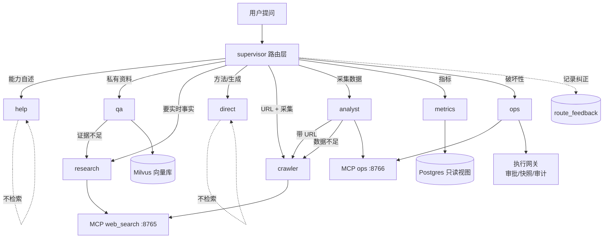
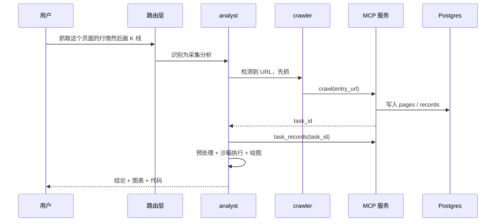

# agents — 多 Agent 结构与协同

九个包：**六个执行 Agent** + 两条不检索路径 + 一个路由层。

## 总体协同

## 一次跨 Agent 请求的样子

## 各 Agent 文档

| Agent | 职责 | 文档 |
|---|---|---|
| `qa` | 内部知识问答 | [qa/README.md](qa/README.md) |
| `research` | 联网研究 | [research/README.md](research/README.md) |
| `crawler` | 网页采集 | [crawler/README.md](crawler/README.md) |
| `analyst` | 数据分析 | [analyst/README.md](analyst/README.md) |
| `ops` | 运维操作 | [ops/README.md](ops/README.md) |
| `ops/metrics` | 系统指标 | [ops/metrics/README.md](ops/metrics/README.md) |
| `direct` | 直接回答（不检索） | [direct/README.md](direct/README.md) |
| `help` | 能力说明（不检索） | [help/README.md](help/README.md) |
| `supervisor` | 路由与协同 | [supervisor/README.md](supervisor/README.md) |
