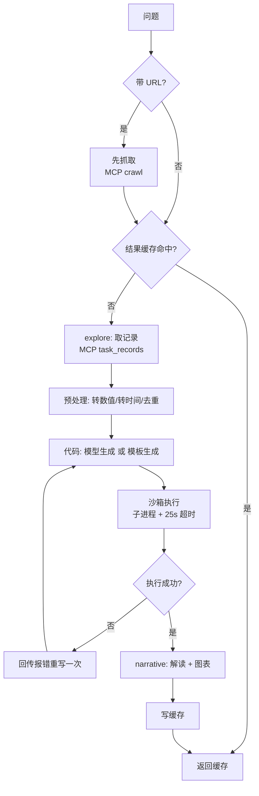

# analyst — 采集数据分析

对爬回来的结构化记录做 pandas 计算与绘图；两条路径：
自然语言（模型写代码）与手动模式（用户定口径，代码按模板生成）。

## 流程

## 手动模式（另一入口）

## 关键文件

| 文件 | 作用 |
|---|---|
| `graph.py` | dispatch → explore → code → narrative |
| `frame.py` | 预处理（`_num` / `_dt` 列生成） |
| `_sandbox.py` | 子进程沙箱（pd/np/plt + kline 助手） |
| `code_runner.py` | 超时、静态筛查、import 白名单 |
| `charts.py` | 图表类型识别（K线/柱状/散点/饼图…） |
| `manual.py` | 手动模式：参数 → 确定性代码 |
| `result_cache.py` | 结果缓存（含数据指纹） |
