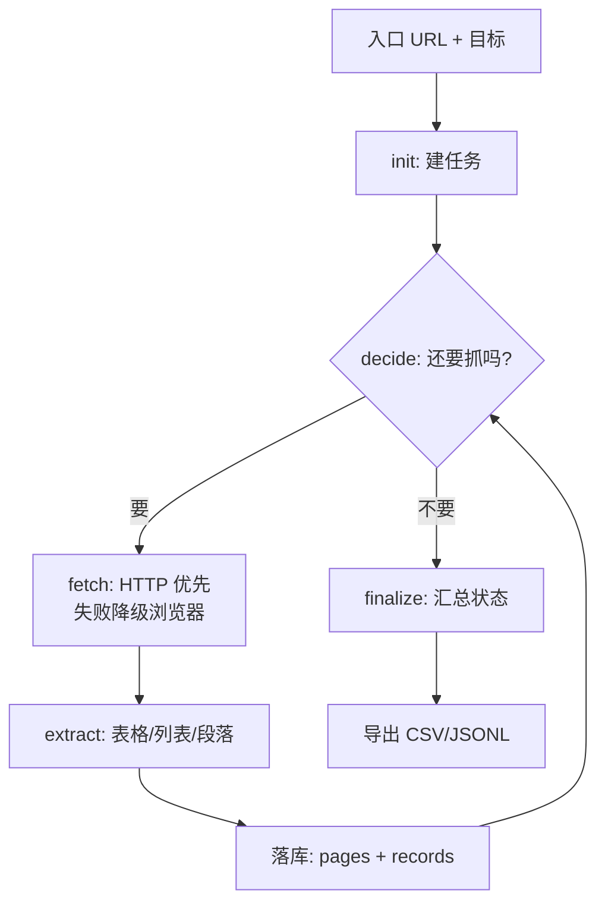

# crawler — 网页采集

给一个入口网址，抓正文、抽表格/列表/段落，落库后可导出文件。
自己决定"还要不要继续抓下一页"，所以图里有循环。

## 流程

## 关键文件

| 文件 | 作用 |
|---|---|
| `graph.py` | 含循环的采集图 |
| `tools.py` | fetch_page / extract_records / find_links |
| `store.py` | crawl_tasks / crawl_pages（含原始 HTML）/ crawl_records |
| `processor.py` | 字段清洗与抽取策略 |
| `exporter.py` | 导出到 `data/crawl/{task_id}` |
| `planner.py` | 选下一个要抓的链接 |
