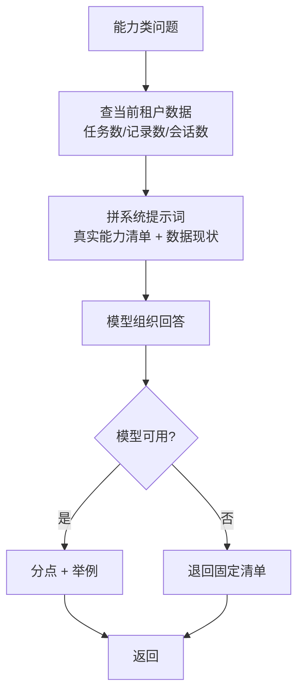

# help — 能力说明（不检索）

回答"你能做什么"。这类问题问的是本系统，交给联网检索会跑偏。

## 流程

## 为什么答案是模型生成的

写死文案会过期（"现在有 4 个 Agent"），也答不了"你能分析股票吗"这类追问。
模型拿到的是**真实能力清单 + 当前租户数据**，所以它说的是"现在真有的"。

## 关键文件

| 文件 | 作用 |
|---|---|
| `nodes.py` | 能力识别 + 快照 + 模型作答（含兜底文案） |
| `graph.py` | 单节点图 |
