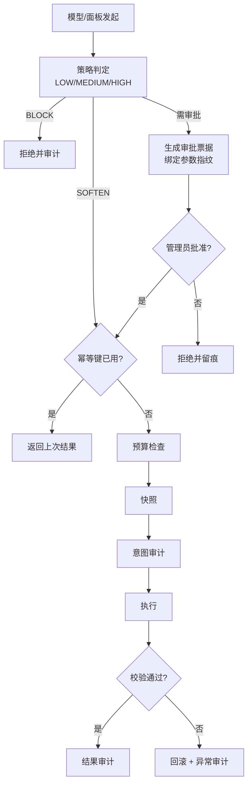

# ops — 运维操作

管理采集任务、清理导出目录与缓存、回收站、审批与审计。
**所有破坏性操作都过网关**，不是直接调函数。

## 破坏性操作流程（网关）

## 关键文件

| 文件 | 作用 |
|---|---|
| `gateway.py` | 执行网关（幂等→审批→预算→快照→审计） |
| `policy.py` | 声明式策略：风险等级与决策 |
| `approval.py` | 审批票据（Redis，绑定指纹，15 分钟过期） |
| `audit.py` | `ops_audit` 两阶段审计（意图 → 结果） |
| `trash.py` | 软删除：移入回收站、恢复、永久清除 |
| `cleaner.py` | 导出目录清理计划 |
| `cache_maintenance.py` | 缓存巡检（问答缓存 + 分析缓存） |
| `graph.py` | 运维 Agent 的工具调用循环 |
