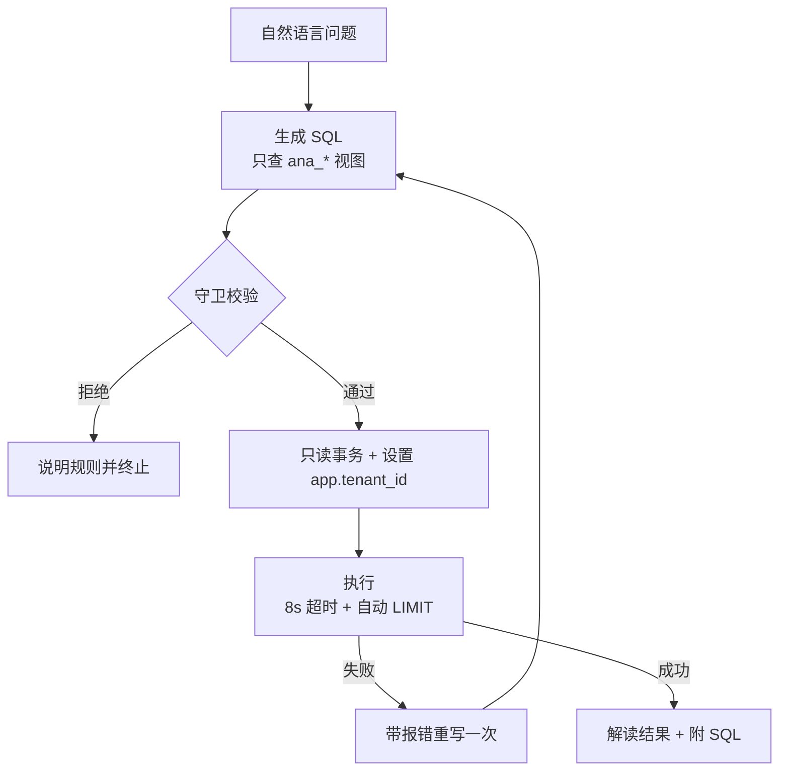

# metrics — 系统指标（运维可观测性的一部分）

用自然语言问"系统跑得怎么样"，后台转成只读 SQL 查视图。

## 流程

## 为什么隔离在视图里

`ana_*` 视图内部写死 `current_setting('app.tenant_id')`，
未设置租户时返回 0 行（Fail-Closed）。模型漏写租户条件也拿不到别家数据。

## 关键文件

| 文件 | 作用 |
|---|---|
| `views.py` | 8 个租户隔离视图 + 指标字典 |
| `sql_guard.py` | 白名单、禁 DDL/DML、禁系统函数、自动 LIMIT |
| `sql_runner.py` | 只读事务 + 租户上下文 + 超时 |
| `nodes.py` | 单节点：生成 → 校验 → 执行 → 解读 |
