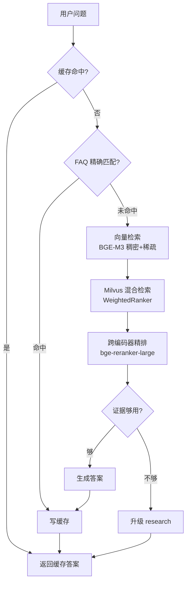

# qa — 内部知识问答

回答产品/业务问题：缓存 → FAQ 精确匹配 → 混合检索 + 精排 → 生成，
答不出时升级到联网（research）。

## 流程

## 关键文件

| 文件 | 作用 |
|---|---|
| `graph.py` | 图定义（缓存 → FAQ → 检索 → 生成 → 写缓存） |
| `faq.py` | 部门隔离的 BM25 索引与精确匹配 |
| `nodes.py` | 各节点实现，含缓存读写 |
| `retrieval/` | 向量库、检索策略、ACL 范围 |
| `compose.py` | 答案合成（内部证据 + 公网证据） |
