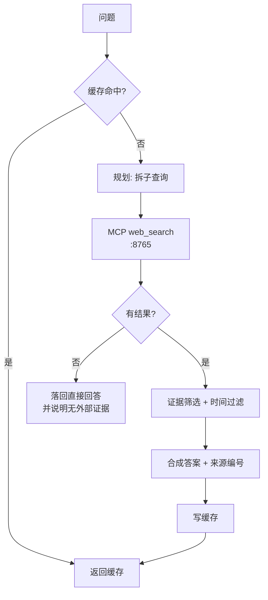

# research — 联网研究

内部知识答不出时检索公开资料，答案带来源编号；支持深度/快速两档。

## 流程

## 关键文件

| 文件 | 作用 |
|---|---|
| `graph.py` | 图：cache_lookup → plan → search → synthesize |
| `planner.py` | 子查询规划（deep / fast） |
| `collector.py` | 调 MCP 检索并归一化结果 |
| `evidence.py` | 证据筛选与引用编号 |
| `time_filter.py` | 时间范围过滤 |
| `mcp_client.py` | MCP 客户端（web-search / ops 两个命名连接） |
