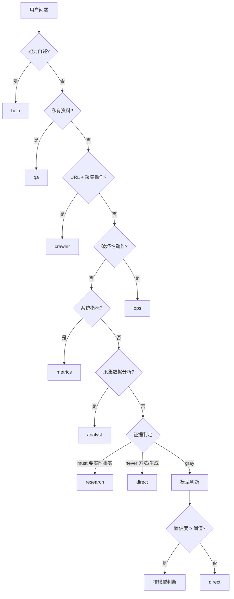

# supervisor — 路由层（多 Agent 协调的入口）

决定一个问题交给谁。不是分类器，而是**闸门 + 证据判定 + 置信度兜底**。

## 路由流程

## 为什么不是分类器

本地 BERT 三分类把"你可以做什么"判成 `research`（置信度 1.00）——
**高置信度不等于正确**，分布外照样给满分。所以：

1. 用户说得很具体的（URL、破坏性动作、指标词）用规则锁死
2. 需要外部事实的按证据判定走 research
3. 方法/生成类直接 direct
4. 灰区交给模型，但**低于阈值一律回 direct**（误检索代价远大于误直接答）

## 关键文件

| 文件 | 作用 |
|---|---|
| `router.py` | 闸门顺序 + 证据判定 + 置信度兜底 |
| `evidence.py` | 三档证据判定（must / never / gray） |
| `local_router.py` | 本地 BERT（现仅兜底） |
| `privacy.py` | 隐私闸门（敏感问题不外发） |
| `feedback.py` | 路由纠正记录（调阈值的依据） |
